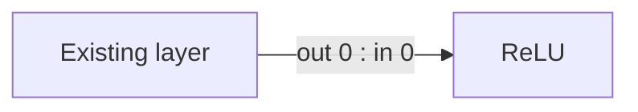
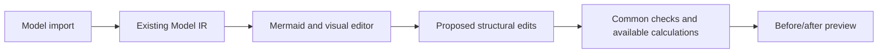
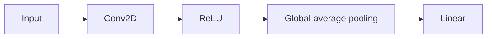

# Model development from Python

Checked against DEEPBOM 2.3.0 on 2026-10-11. The code below uses existing APIs.
The Structure IDE below is part of the Web update dated 2026-10-11.
The Python examples describe the published 2.3.0 interfaces.

## Choose an entry point

| Task | Entry point | Current scope |
| --- | --- | --- |
| Inspect an exported model | Node/Python static SDK or CLI | Artifact evidence without executing model code |
| Change a trainable model | Python `deepbom.optimization` | Supported in-memory PyTorch/Keras objects or explicit local factories/files |
| Record training evidence | Python `deepbom.training` | Qualified Torch loops, eager GradientTape and Keras fit callbacks |
| Inspect recorded observations | Local DeepBoard | Read-only plots, tensor selection, explicit refresh and exports |
| Compare saved candidates | Candidate HTML/PDF/JSON report | Before/after structure, state correspondence, rule reasons and scoped checks |
| Connect external evaluation | `evidence_workflow` / `evidenceWorkflow` | Same context and calculation owners as Web, CLI and local MCP |

Python is the current model-development interface: it receives the actual model
object and returns a candidate model that the caller can train. CLI is useful
for reproducible commands, scripts and CI. A visualization should consume these
same results rather than create another implementation of model arithmetic.

The following loop can run in a Python script or notebook using the qualified
Linux x86-64 wheel. Install only the framework extra needed:

```sh
python -m pip install 'deepbom[torch] @ https://github.com/JunHwan-Kwon/deepbom/releases/download/channels-v2.3.0/deepbom-2.3.0-py3-none-linux_x86_64.whl'
```

This installation example is not a Windows/macOS native qualification. The
[native guide](NATIVE_MODEL_TRAINING_GUIDE.md) defines framework versions, Keras
inputs, custom-factory requirements and the execution boundary.

## An executable candidate loop

This toy model has no task training or quality claim. Structure replacements
initialize affected weights; unaffected state is preserved. An empty explicit
rule list produces an unchanged candidate, useful for reviewing an alternative.

```python
from pathlib import Path
import tempfile
import torch
from torch import nn
from deepbom.optimization import optimize, refine, load_model

torch.manual_seed(7)
model = nn.Sequential(
    nn.Conv2d(8, 16, 3, padding=1),
    nn.ReLU(),
    nn.AdaptiveAvgPool2d(1),
    nn.Flatten(),
    nn.Linear(16, 2),
)
example = torch.randn(1, 8, 16, 16)
work = Path(tempfile.mkdtemp(prefix="deepbom-development-"))

candidate = optimize(
    model, objective="structure", example_args=(example,),
    output_dir=str(work / "candidate"),
)
unchanged = refine(
    candidate, rules=[], objective="structure", example_args=(example,),
    output_dir=str(work / "unchanged"),
)
print(candidate.validation["candidate_status"])
print(candidate.comparison["totals"])
print("Changed candidate:", work / "candidate" / "report.html")
print("Unchanged alternative:", work / "unchanged" / "report.html")

# Inspect both reports; choose a package explicitly before training.
selected_directory = work / "candidate"  # Or work / "unchanged".
selected = load_model(str(selected_directory))
selected.train()
optimizer = torch.optim.Adam(selected.parameters(), lr=1e-3)
# The caller supplies its own data, loss and training loop.
```

Open the printed HTML files in a browser. `candidate.model` is also available
directly in memory; `load_model` instead checks and restores the selected frozen
package. Subsequent training changes the mutable model, not that saved package.
`refine` starts from the frozen baseline; it does not silently stack changes.

This example uses scalar `AdaptiveAvgPool2d(1)`. Version 2.3.0 has a reproduced
[tuple-configuration restoration issue](KNOWN_ISSUES.md#deepbom-230-tuple-valued-native-layer-configuration)
with `AdaptiveAvgPool2d((1, 1))`; package export rejects the changed identity.

For inference folding, `objective="cpu_inference"` has a separate boundary:
eligible Conv–BN pairs in evaluation mode, with supported topology and running
statistics. It does not preserve training-mode BN behavior. Structure changes
require training/evaluation. Neither route proves faster runtime execution;
measure latency on a separately identified target/build with stated inputs.

Training observation is independent of candidate optimization. Attach the
[existing collector](NATIVE_MODEL_TRAINING_GUIDE.md#training-pytorch-and-gradienttape)
to the selected model or the original model, then view its recorded directory:

```sh
python -m deepbom.training view run-evidence
```

This viewer never executes the model. Weight/activation plots require their
captured evidence; metrics-only runs do not acquire those plots automatically.

## Web Structure IDE

Open a local artifact, select **Run Static Audit**, then **Redesign → Structure
IDE**. This workspace consumes the existing Model IR; it does not execute model
code or upload model bytes. A serialized operation graph is required. Tensor-only
artifacts such as GGUF and SafeTensors do not acquire an invented graph.

1. Select a layer, or find it in the left-hand list. Drag a node to arrange the
   view; drag its bottom output handle to a top input handle to change the graph.
   Sequential connections flow downwards; skip/residual edges use outside lanes.
   Stored inputs remain labeled inside the card. Hover or select a layer to
   highlight adjacent connections; **Trace selected** highlights its upstream
   and downstream paths. **Arrange** restores the automatic layout. Obstructed
   routes caused by overlapping cards are dashed; move the cards or use Arrange.
   Layout and routing do not change tensor bindings, Model IR, or calculations.
2. Use the inspector to select exact input bindings, change exposed native
   scalar/list attributes, duplicate/delete a layer, or bypass a unary layer.
   Model output bindings are editable separately. Duplicated layers initially
   share their original input/state bindings; no new weights are generated.
3. Add **Identity**, **ReLU** or **Add** templates from the palette. Insert a
   unary template before an input from the inspector. Explicit input positions
   preserve the order of branches and merges. Each template lists its input/output
   count and supported contract checks, with **Insert code** and **Copy code**.
   To reuse a native layer (for example an imported convolution), select it and
   use **Duplicate**, **Insert layer code** or **Copy layer code**. Native copies
   retain attributes and input/state references; this does not initialize weights
   or establish that a changed native layer can execute. Layers with control,
   state or nested-region ownership cannot be duplicated by this generic rule.
4. Inspect before/after changes, disconnected ports, cycles and applicable
   template shape/dtype checks. Undo/Redo and candidate snapshots use one history.
5. **Structure code · Mermaid** opens beside the graph on desktop (stacked on
   narrow screens). Graph edits update clean code immediately. **Replace code from graph**
   means **Graph → Code**, explicitly replacing this region's code draft.
   Edit the code, then **Apply code to graph** means **Code → Graph**: validate and apply
   new layers and connections as one undoable edit. Typing alone does not change
   the graph. Keep existing declarations unchanged; new nodes require unique IDs
   and a `:::template_Name` or `:::copy_nN` annotation. These are ordinary Mermaid
   class annotations, interpreted as bounded edit instructions by this editor.
   `out N : in N` identifies layer ports; `out N : output N` binds a model output.
   Edit native attributes in the inspector. This is bounded Mermaid, not Python
   or arbitrary executable-model import.
6. **Save project** downloads source-bound edits. Reopen the original model and
   use **Open project** to restore them. **Download Mermaid** shares the diagram.

The workspace shows the original filename, format and artifact identity above
the panels. **Focus mode** expands the editor (Esc returns); **Focus layer** moves
the canvas to the selection. **Locate in code** selects that layer's declaration.
The code panel has synchronized line numbers, a width control and Ctrl/Cmd+Enter
to apply pending code. Ctrl/Cmd+Z and redo shortcuts work on the graph; text fields
retain their own editing shortcuts. Search and pane scroll positions survive
ordinary graph updates. Narrow and embedded workspaces stack panels according
to their container width, including in focus mode.

For an original, primary-region TFLite operator, the inspector can open its owning
**source block scenario** in the existing optimizer. The link verifies the
artifact identity and resolves the source Model IR operation to its block. Added
or copied draft layers do not acquire a source-block identity. Switching back
preserves the structure draft and pending code. This is a navigation connection:
the block engine still computes from the original TFLite and its block-edit
request. It does **not** compute costs for arbitrary Structure IDE graph edits.
The original-model label and this boundary remain visible beside the action.

For example, append a ReLU to an existing `n0` output in the generated code:



This excerpt is not a replacement for the complete generated diagram. To insert
the layer into an existing path, also replace the relevant downstream connection
with `relu_1 -->|out 0 : in 0| n1` (using that downstream port's actual position).
Otherwise it is an additional branch. **Insert code** wires a new template's
first input to the selected layer's first output when available; **Add** still
requires a second explicit input. A copied native layer snippet includes all its
input/state connections. Repeated insertion chooses fresh aliases; manually
pasting a snippet again requires renaming its new alias and associated edges.
For a native copy, `copy_1["Conv"]:::copy_n0` means copying existing `n0` with its
exact generated label, not looking up an operator by the word `Conv`.

Each code sync allows at most 100 new layers. Duplicate IDs, unsupported templates,
changed existing declarations and incomplete/invalid wiring are rejected before
history changes. Code-created layers replay through the same constructors as
canvas additions. Duplicating a template also preserves its shape-rule identity.
The `structure_code` project command is rejected by older readers that do not
implement code-based additions; it cannot silently degrade into connection-only
edits. If clipboard access is blocked, the copy action exposes a selected snippet
for manual Ctrl+C / Cmd+C.

Unapplied code survives graph edits, layout changes, panel hiding and region
switches. If the graph revision also changes, code application is blocked until
the text is reconciled with the current graph; stale aliases are never silently
reinterpreted. Download pending text before replacing it with **Replace code from graph**.
Syntax, unknown/duplicate port, missing output, cycle and supported shape errors
leave the graph/history unchanged. Pending code must be applied or explicitly
replaced before saving a project/candidate; project files contain committed edits.
Reset, project replacement and saved-candidate loading also require resolving
pending code. If the workspace changes while a project file is being read, the
load is rejected instead of overwriting newer edits.

The core reuses Model IR graph-link validation and common broadcasting/storage
arithmetic. An edited native operation and its data-dependent successors lose
their old shape/cost claims; missing recalculation is **unassessed**, never zero.
Only the explicit editor templates currently infer new output contracts. A graph
with no connection errors still has partial semantic validation.

Project files contain edits and source identities, not model weights or a
trainable artifact. Native export and arbitrary graph cost recomputation are
future integration work. For existing TFLite rule-based projection, choose
**Block optimization** in the same Redesign workspace. It uses the original
artifact and existing WASM block rules; it does not consume arbitrary IDE edits.

Verified scenarios include ONNX/TFLite/Core ML, nested ONNX regions, immutable
source, shared state, project tamper rejection, undo/redo, cycle and broadcast
errors, actual browser port dragging, Mermaid edits, light/dark/mobile layouts,
and the normal ONNX upload/audit/navigation path.

## Further interactive integration

Scope: open a model, understand its structure, edit supported nodes/connections
and inspect the before/after difference. The primary interaction is a visual
node editor: drag an output port onto an input port, insert or replace a layer,
and inspect the resulting data flow. Mermaid provides a synchronized optional
text view and sharing format over the same common structure. Do not require
a new model language, independent ModelSpec, or user-authored operator semantics.
The broader optimization/export integration below remains a design direction;
the implemented subset and its limits are listed above.

### Port-based editing and optimization loop

The initial screen has a layer/block palette, a zoomable graph canvas and a
selection inspector. A before/after comparison panel shows the current candidate.
Text editing is optional; a user can complete ordinary edits with the mouse.

| User action | Shared structural effect |
| --- | --- |
| Drag an output handle to an input handle | Propose an exact producer/value/consumer-port binding |
| Drop a supported layer onto a connection | Preview insertion and explicit input/output port bindings |
| Remove, duplicate or replace a layer/block | Preview affected connections and state references; never silently reconnect ambiguous ports |
| Change channels, kernel or another supported attribute | Recheck affected shapes and recompute applicable static metrics |
| Add a branch or merge | Show every distinct input port and its order; diagnose incompatible shapes or missing inputs |
| Select a region and request optimization | Show applicable existing rules, reasons and proposed edits before application |
| Accept, adjust, reject or undo a proposal | Use the same edit history and validation path as manual edits |
| Compare and save candidates | Preserve the baseline and show structural changes plus retained/new/incompatible state |

Port annotations show known shape, dtype and layout. Distinguish a confirmed
incompatibility from an unknown constraint. Connecting nodes updates graph
structure; merely dragging a node to a new screen position updates layout only.
Do not infer input order from canvas position. The initial static-graph editor
must reject unsupported feedback connections rather than invent loop semantics.

Optimization and manual edits share one proposal/check/diff path. Shape, count,
storage and compute estimates are recomputed where supported; measured latency
and task quality require separate observations. Show stale or pending results
while recalculating. Structural changes alone do not establish successful
weight reuse or a performance improvement.

Existing UI toolkits provide the interaction primitives: React Flow documents
[multiple handles](https://reactflow.dev/learn/customization/handles) and
[connection validation](https://reactflow.dev/examples/interaction/validation);
[Vue Flow](https://vueflow.dev/guide/) provides custom nodes and connections;
[Rete.js](https://retejs.org/docs/guides/connections/) provides socket connection
interactions. Library selection needs an integration check with the existing Web
application. Its UI graph must remain a view over the common IR edit state; do
not adopt another graph execution engine or duplicate DEEPBOM calculation rules.

### Existing textual languages reviewed

The requirement is a textual graph notation for the common structural IR.
The following official sources were checked on 2026-10-11; suitability is a
DEEPBOM design judgment, not a claim that these projects implement our IR.

| Existing notation | Relevant support | Fit for this interface |
| --- | --- | --- |
| [Mermaid flowchart](https://mermaid.js.org/syntax/flowchart.html) | Named nodes, directed/labeled connections and subgraphs; [GitHub Markdown support](https://docs.github.com/en/get-started/writing-on-github/working-with-advanced-formatting/creating-diagrams) | Preferred simple structural editing and sharing syntax |
| [Graphviz DOT](https://graphviz.org/doc/info/lang.html) | Nodes, edges, attributes, ports and subgraphs; [Keras model-to-DOT utility](https://keras.io/api/utils/model_plotting_utils/) | Strong alternative if explicit attributes must be authored in one graph text file |
| [ONNX textual syntax](https://onnx.ai/onnx/repo-docs/Syntax.html) | Typed graph inputs/outputs, operator calls and attributes; documented as experimental | Useful ONNX-specific adapter, not a neutral syntax for every source format |
| [Khronos NNEF](https://registry.khronos.org/NNEF/specs/1.0/nnef-1.0.5.html) | Human-editable neural-network structure with standardized operations and separate tensor data | Relevant model-interchange precedent; adopting its operator model exceeds structural editing scope |
| [MLIR textual form](https://mlir.llvm.org/docs/LangRef/) | Operations, values, types, attributes, blocks and regions | Rich IR representation; dialect integration is unnecessary for the first simple editor |

Choose a bounded Mermaid flowchart profile and document its mapping to existing
IR subjects. This is a textual view of the same structure, not a new IR or an
operator implementation language. Node IDs resolve subjects, arrows describe
declared relationships and named subgraphs represent declared structural groups.
Input/output port indices and relationship kinds need explicit project bindings
or documented label conventions: Mermaid does not assign tensor semantics to
them. DOT ports and arbitrary attributes likewise require an IR mapping.

Preserve non-displayed properties when importing edits. Do not treat a collapsed
operation-only diagram as a lossless encoding of all values, ports, regions,
storage and provenance. Ambiguous edits are diagnosed. Sharing a Mermaid diagram
and editing its graph within the original project are distinct supported goals;
neither implies a universal executable model round trip.

### Existing IR, shared edits

Reuse the Model IR program subjects, values, ports, relationships and available
operator attributes. Keep original framework attributes and state references
through the existing adapters. An edit changes the structure or a supported
attribute; the user does not implement the operation's numerical behavior.



For example, a graph can be shared using ordinary Mermaid:



Within the project, diagram IDs map to exact IR subjects. Editing a connection
or changing an existing attribute in the inspector submits the same edit request
as the corresponding visual action. Labels remain display text; changing a
label does not change the operation type. New nodes select a supported operation
from existing contracts. Ambiguous multi-input port assignments require an
explicit selection, not an inference from diagram layout.

### Preserve evidence while editing

Current Model IR documents are bound to source evidence and validated hashes.
Keep that baseline immutable. Store proposed edits against its identity and
construct a draft structural view using the same graph types. The draft is an
editor state, not another Evidence IR family member and not observed artifact
evidence. Do not pass an edited copy with stale source hashes off as validated
Model IR, or weaken source validation to make it pass.

Shared structural checks must cover subject/reference integrity, port bindings,
block membership and applicable shape/dtype/layout constraints. Reuse existing
calculation owners; factor reusable checks out of source-bound validators where
necessary instead of copying rules into the editor. Schema validity alone does
not establish shape compatibility or executability. Unknown constraints remain
explicitly unassessed. Invalidate affected metrics and overlays after an edit;
recompute supported results and label them as draft projections.

The first deliverable is a structural preview and diff. A later explicit Apply
or Export action uses supported existing framework adapters, creates a candidate
and captures fresh evidence. Reusing IR does not by itself guarantee every
imported format can be exported as a trainable model. Original weights remain
bound to the original state; changed dimensions must not silently inherit them.

### Minimal interface and acceptance criteria

- One local Web view: a layer palette, graph with draggable input/output handles,
  a property inspector and optional Mermaid text. No separate manual JSON editing
  is needed for ordinary supported changes.
- One undo/history stream and one shared edit/check path for all controls.
  Visual position changes must not alter execution relationships.
- A before/after diff with changed nodes, connections, attributes and available
  static effects. Unsupported calculations are shown as unassessed, not zero.
- Project-scoped edits preserve unmodified attributes, ports, shared-state
  references and baseline identity. Changed connectivity invalidates dependent
  results. Structural previews never claim measured speed or accuracy gains.
- Export ordinary Mermaid for sharing. Mermaid-only imports are diagrams until
  their subjects and missing properties are resolved. Diagram text alone does
  not carry a complete model or its weights.
- CLI and local MCP should use the same edit requests and common checks when
  exposed. Desktop and VS Code can wrap the same editor later. A new wrapper is
  not a prerequisite for the first Web interface.

Existing report and DeepBoard tests do not establish editor correctness. Verify
text/visual edit parity, rejected invalid references/port assignments, stale
metric invalidation, undo, baseline preservation and structural diff before
calling this feature implemented. Supported candidate export additionally
requires adapter-specific restoration and fresh-evidence checks.

See [automatic development integration](AUTOMATIC_DEVELOPMENT_INTEGRATION.md) for opt-in monitor, Keras/Lightning adapters, immutable analysis jobs, metric plugins and bounded report queries.
