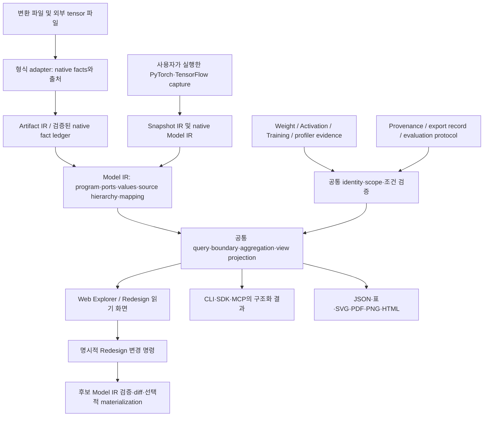

# 원본 계층·텐서 연결·분석 화면을 통합하는 개발 계획

작성: 2026-10-12. 상태: **검토 및 개발 계획 — 아래 확장 기능의 구현 완료를 의미하지 않음**.

구현 후속: [공통 source hierarchy 구현·호환 계약·사용법](SOURCE_HIERARCHY.md). 2.4.0에서 P0/P1의 metadata·포트 경계·집계·보존 검사와 P2의 기본 탐색/출력을 구현했다. 아래 H01–H36 전체, 특히 native 호출 추적과 P3/P4 연구 분석의 완료를 의미하지 않는다. 채널별 게시 여부는 해당 릴리스에서 별도로 확인한다.

검토 기준은 저장소 commit `5c065dc663533f51975972eee23e153cafba90ea`이다. 로컬 코드, 제공된 비공개 연구 산출물, 공식 문서를 대조했다. 운영 사이트와 배포된 모든 클라이언트가 이 commit과 동일하다는 주장은 하지 않는다. 연구 파일·모델·환자 사례·원본 경로는 이 문서에 포함하지 않는다.

## 1. 결정

원본 계층과 실제 텐서 연결을 함께 보존하고, **검증된 공통 Model IR에서 같은 조회·집계·표시 데이터를 만들어 그림, 표, CLI, MCP, export가 함께 소비하도록 개선한다.** 이 제안은 현재 Evidence IR 원칙에 부합한다.

계층 복원과 정확성 문제를 먼저 해결하고, activation·gradient·probe·ablation은 그 위에 연결한다. 기존 파일 파서와 계산을 화면별로 다시 구현하거나, 특정 연구 모델의 Encoder/Decoder 배치를 제품의 일반 규칙으로 가져오지 않는다.

핵심 결정은 다음과 같다.

1. 원본 모듈의 포함 관계, 호출 관계, 텐서 데이터 흐름, 학습 의존 관계를 별개의 관계로 유지한다.
2. module 정의/인스턴스/별칭, 각 호출, 변환된 연산, 저장 객체를 구분한다. 이름이 같거나 바이트 값이 같다는 이유로 합치지 않는다.
3. 출처 annotation은 파일에 기록된 주장으로 보존한다. 그것만으로 실행 확인, 원본 코드 동등성, 학습 파라미터 수를 입증하지 않는다.
4. 계층은 Model IR 소유 확장이다. 별도의 Hierarchy IR·Gradient IR·Trained IR를 즉시 추가하지 않는다. 보조 문서는 공통 검증기를 통과하고 기존 IR의 digest와 subject를 참조한다.
5. 구조를 접는 것은 표시 변경이다. Redesign에서 계산 구조를 바꾸는 것은 별도 변경 명령이다.
6. 기존 schema의 필드를 임의로 늘리지 않는다. 기존 출력 계약과 새 기능을 명시적으로 선택할 수 있게 한다.

## 2. 현재 확인한 것과 확인하지 않은 것

| 구분 | 확인 결과 | 조치 |
| --- | --- | --- |
| DEEPBOM 파서의 구체적 누락 | `web/onnx.js`의 `parseNode`는 NodeProto의 `metadata_props`를 읽지 않는다. 모델·그래프 metadata 지원과 별개이다. | 노드 metadata 보존, 크기 제한, 중복·잘못된 값 처리, 출처 binding 추가. |
| DEEPBOM 구조 요약의 한계 | 현재 반복 구조 partition은 원본 클래스/모듈 트리 복원이 아니다. 큰 잔여 `tail`도 유효한 partition일 수 있으나 구조 이해에는 불리하다. | 원본 계층을 사용할 수 있으면 별도 명시적 projection으로 우선 제공. 기존 partition 의미는 유지. |
| DEEPBOM 표시 상태의 문제 | `architecture-overview`만 요청해도 manifest가 exhaustive 페이지의 누락으로 `conservation.status=failed`를 기록한다. 공개 ONNX sample에서도 재현했다. | 데이터 보존, 요청한 view 검증, 직접 표시 범위를 분리. 기존 v1 의미를 몰래 변경하지 않음. |
| 현재 grouping의 한계 | `graph-hierarchy.js`는 stage/domain/chunk 기반이며 contraction에서 원래 edge ID·포트 전체를 보관하지 않는다. 외부 연결은 주로 개수로 처리된다. | 원본 edge multiset과 boundary port를 유지하는 공통 projection 필요. |
| 추가로 검증해야 할 코드 경로 | `model-summary.js`의 block output은 마지막 member의 output만 사용하고 predecessor는 빈 배열이다. 분기 그룹의 전체 경계를 표현하지 못할 수 있다. | 다중 output·중간 skip oracle을 먼저 추가하여 기대 계약과 대조. |
| 추가로 검증해야 할 호환 projection | `graph-ir.js`는 consumer가 없는 value에만 graph output edge를 생성한다. 내부에서도 소비되는 graph output 사례를 별도 시험해야 한다. | 회귀 fixture로 확인. 새 계층의 기준을 이 legacy primary-scope projection에 두지 않음. |
| 이미 있는 정확성 기반 | Model Summary는 exact integer, unique storage, unknown 상태와 trainability 한계를 이미 갖고 있다. | 재사용. `macs or 0` 형태의 두 번째 집계기를 만들지 않음. |
| 이미 있는 native 기반 | PyTorch collector는 객체 identity 기반 state alias와 module tree를 수집한다. module containment를 실행 그래프라고 주장하지 않는다. | 실행/추적 graph와 call occurrence를 추가하여 연결. |
| 이미 있는 lifecycle 기반 | Snapshot IR, Training IR, typed Provenance, evaluation/deployment evidence, 공통 evidence workflow가 구현돼 있다. | 새 shadow workflow 대신 이 경로로 연결. 과거 계획 문서의 미구현 표를 현재 상태로 사용하지 않음. |
| 사용자 측 보완 파이프라인 | 미매핑 연산을 일괄 input/output으로 분류, `macs or 0`, checkpoint hash만으로 export 재사용, 실행 완료와 수치 검증의 분산을 확인했다. | 별도 integration 개선 항목. DEEPBOM 엔진의 계산 오류로 일괄 귀속하지 않음. |
| 제공된 연구 산출물 | ONNX의 노드·입출력 포트·source metadata 존재를 독립적으로 읽어 대조했다. 저장된 export 검증에는 일부 허용 오차 초과가 있다. | 비공개 검토 기록으로 보존. 이번 검토에서 native 실행이나 수치 일치를 다시 측정한 것은 아님. |
| 아직 재현하지 않은 주장 | 모바일/논문 글자 크기, 대비 비율, 특정 원본 연산의 상수화 원인, 실제 gradient/성능/임상 해석. | 보고된 관찰과 향후 검증 과제로 구분. |

원본 residual block 수와 자동 structural group 수, 학습 파라미터 수와 serialized element 수는 각각 다른 지표이다. 숫자가 다르다는 사실만으로 버그라고 판단하지 않는다. 원본 경로가 모든 연산에 존재해도, 모든 호출·fusion·constant folding의 대응이 정확하게 복원된다는 뜻은 아니다.

## 3. 공통 소유권과 흐름



위 그림의 합류는 서로 다른 schema를 무조건 한 객체로 변환한다는 뜻이 아니다. artifact-bound Model IR와 native Model IR의 지원 범위를 유지하고, 검증된 공통 조회 인터페이스로 접근한다.

| 책임 | 기존 소유 코드 및 확장 방향 |
| --- | --- |
| 파일 파싱 | `web/onnx.js` 및 각 format adapter. metadata를 UI에서 다시 읽지 않음. |
| Artifact→Model binding | `web/lib/artifact-ir-context.js`, `web/lib/artifact-ir/`, `web/lib/model-ir.js`, `web/lib/model-ir/`. |
| 보조 native 사실 | `web/lib/model-ir/internal/native-facts.js`. 현재 allow-list와 frozen Artifact IR 경계를 유지하면서 명시적으로 version 관리. |
| 호출/계층/대응 규칙 | Model IR 내부의 전용 모듈로 분리. 데이터 모델과 validation을 먼저 정의하고 renderer와 분리. |
| 숫자·집계 | `web/lib/exact-integer.js`, `web/lib/model-summary.js`, 기존 metric owners. 단일 boundary/aggregate API를 모두 사용. |
| 화면 projection | `web/lib/graph-hierarchy.js`, `web/lib/model-ir-visualization.js`, graph layout/export. canonical topology는 Model IR에서 받음. |
| 구조 편집 | `web/lib/model-structure.js`, `model-structure-editor.js`, `structure-wire-routing.js`, 기존 redesign workflow. |
| 상태·실험 연결 | `snapshot-ir.js`, `native-evidence.js`, `evidence-context.js`, `provenance-v2.js`, `evidence-workflow.js`. |
| 학습 capture | `channels/python/src/deepbom/_native/adapters.py`, `channels/python/src/deepbom/training/`. |
| 채널과 계약 | `sdk/`, CLI, `evidence-query-contract.js`, 각 MCP handler, schemas, compatibility catalog generator. |

`graph_ir`는 legacy 호환 view이며 새 기능의 canonical source가 아니다. TensorFlow function/control facts처럼 현재 Artifact IR에 담지 못한 사실은 명시적 native fact ledger 경로를 이용한다. 허용하지 않은 raw native JSON을 renderer가 직접 읽는 우회는 만들지 않는다.

## 4. 계층·호출·대응 데이터 계약

아래 이름은 설계 항목이며 아직 출시된 필드/API 이름이 아니다. P0에서 schema와 오류 코드를 확정한다.

| 개념 | 반드시 유지할 내용 |
| --- | --- |
| Source module | snapshot/source definition ref, 모듈 instance ID, 모든 alias path, class, 부모별 포함 관계, 설정, parameter/buffer ref. |
| Call occurrence | graph/capture scope, module ref 또는 functional operation, call-site ref, occurrence ID, 입력 조건과 trace 범위. 호출을 알 수 없으면 unknown. |
| Serialized operation | 기존 subject ref, graph region, native operator/domain/version, input/output port 및 value ref. |
| Source mapping | 여러 source/call ref ↔ 여러 operation/value ref, 근거 pointer, producer/version, 방법, status, unresolved reason. |
| Transformation relation | source snapshot와 export artifact/set의 identity, 코드/설정/환경, 대응 문서 digest, 수치 검증 문서 ref. Provenance와 연결. |
| Display group | 표시 목적, member operation ref, 하위 그룹 ref, boundary value/port/edge ref, grouping rule/version. source module과 동일하다는 주장 여부. |

### 4.1 대응 상태와 증거 수준

- exporter annotation을 읽었다는 사실과 annotation 내용의 진실성을 구분한다. `observed metadata`, `declared source identity`, `derived mapping`, `observed execution`은 같은 증거 수준이 아니다.
- `exact/ambiguous/unmapped/not_applicable`처럼 대응의 확실성과 `one-to-many/many-to-one` 같은 cardinality를 별개로 표현한다. 이름 일치만으로 exact를 부여하지 않는다.
- source class가 확인된 GroupNorm을 펼치면 serialized operations를 그대로 보여준다. operator pattern만으로 발견한 GroupNorm 후보는 추정임을 표시한다.
- 없어져 보이는 연산을 자동으로 `constant-folded`로 판정하지 않는다. 변환 기록이나 원본 graph와의 대응 근거가 없으면 `not represented / reason unknown`으로 둔다.
- 동일 source module의 반복 호출은 서로 다른 call ID를 갖는다. module parameter는 중복 계산하지 않지만 call별 연산량은 별개이다.
- 같은 이름의 module이 여러 graph/function에 있어도 scope를 통해 구분한다. original class hierarchy와 module path는 문자열 치환으로 서로 변환하지 않는다.

metadata adapter는 exporter/version별 encoding을 판별한다. JSON과 Python 문자열 표현을 구분하고 `eval` 없이 제한된 문법으로 읽는다. 중복 key, 깨진 annotation, 최대 개수/길이/중첩을 검증한다. 잘못된 부가 annotation은 해당 mapping을 unavailable/invalid로 만들되, 안전하게 분석 가능한 원본 topology까지 없애지 않는다. 전체 파일의 안전한 파싱을 막는 resource limit 초과는 별도 오류이다.

같은 stack/scope 문자열은 내부 string table로 공유할 수 있으나 evidence 위치는 잃지 않는다. 외부 metadata는 신뢰하지 않는 문자열로 취급하여 HTML/SVG/Mermaid 및 CSV의 문맥에 맞게 안전하게 출력한다. 표시 최적화가 검증에 필요한 원본 값을 변경해서는 안 된다.

역할·decomposition·grouping 규칙은 rule ID/version, 입력 source 요구조건, 적용 operator/opset 범위, 판정 근거와 미충족 조건을 갖는다. Web/CLI/MCP에서 각자 이름 기반 규칙을 만들지 않는다. 사람이 덧붙인 역할 annotation은 사용자 선언으로 별도 저장한다.

### 4.2 식별자

- 기존 operator/value/port ID를 재번호 매기지 않는다. 문서 digest와 subject ref를 함께 사용한다.
- source instance ID는 snapshot-local, 호출 ID는 graph/capture-local이다. 메모리 주소를 장기 식별자로 저장하지 않는다.
- 버전 간 대응은 별도 correspondence 결과이다. 경로·class·설정·port 계약·호출 위치·state 연결을 근거로 exact/partial/ambiguous/unmatched를 반환한다.
- 이름 변경으로 수치가 달라져서는 안 된다. 반대로 이름이 같다고 이전 annotation이나 activation을 자동 승계해서도 안 된다.

## 5. 정확한 topology와 가역적인 접기·펼치기

연결의 기본 단위는 `(scope, producer operation/output port, value, consumer operation/input port)`이다. 실제 format에 맞는 model input/output, initializer, 외부 capture, control 관계는 각각 명시한다. 동일 value를 두 input port에서 사용하는 경우 edge를 두 개로 유지한다.

각 projection은 다음 분할을 검증한다.

```text
전체 operation = 표시 leaf + 접힌 group 내부 leaf + 명시적으로 제외된 leaf
전체 data edge = group 내부 edge + group 사이 edge + 선택 범위 boundary edge
```

검증은 단순 개수 합계가 아니라 **ID/port를 포함한 multiset의 일치**로 수행한다. 하나를 누락하고 다른 하나를 중복한 결과가 통과하면 안 된다. 별도의 control edge와 module-containment edge를 data edge 수에 섞지 않는다.

구현 규칙:

1. 그림과 표가 동일한 boundary query를 호출한다. block output을 마지막 연산의 output으로 대체하지 않는다.
2. graph output이 다른 내부 operation에도 들어갈 수 있다. 내부 edge와 output boundary를 모두 유지한다.
3. 합쳐 그린 선에는 전체 constituent edge refs가 남는다. 클릭하거나 펼치면 원래 tensor·포트·shape·dtype을 복구한다.
4. 선택 module export에서도 바깥에서 들어오는 skip, 밖으로 나가는 중간 output을 boundary port로 표시한다.
5. 소속이 불명확한 operation은 `Unclassified`로 둔다. 실제 graph boundary와 원본 근거로 확인한 전처리/후처리만 해당 이름을 사용한다.
6. 한 operation이 여러 원본 모듈과 대응할 때 provenance membership는 중복을 허용한다. 집계용 disjoint partition은 별도이며 공유/미확정 항목을 명시한다.
7. 포함 트리를 접는 과정에서 quotient graph에 cycle이 생길 수 있다. 원래 DAG라는 이유로 선을 삭제하거나 순서를 꾸며내지 않는다. compound layout 또는 호출 단위 분할을 적용한다.
8. ONNX subgraph의 outer-scope capture, function, If/Loop의 정적 body와 실행 횟수를 구분한다. 미전개 영역을 누락 없이 표시하되 실행 경로 전체를 안다고 주장하지 않는다.

## 6. 집계·상태·단위의 공통 규칙

### 6.1 수치

| 지표 | 집계 기준과 제한 |
| --- | --- |
| 원본 trainable parameters | native snapshot의 고유 parameter 객체와 trainable 상태. 부모+자식 합산 금지. 서로 다른 객체가 같은 storage를 사용하는 경우 객체 수/원소와 storage alias를 각각 설명. |
| serialized elements / bytes | 고유 storage object 또는 명시된 native storage 계약. 같은 값/같은 내용 hash만으로 서로 다른 저장 객체를 합치지 않음. |
| MACs | 기존 contraction 계산 규칙, 입력 shape 및 동적 제약, assessed compute-op 범위. normalization·activation 비용이나 latency와 동일시하지 않음. |
| logical I/O / activation bytes | dtype와 shape에 따른 논리적 값. edge traffic 합과 unique allocation, peak live memory, 실제 allocator 측정은 별도 지표. |
| 실행 시간·메모리 | 측정 환경·warm-up·반복·동기화·thread/delegate/device 조건이 있는 profiler evidence만 measured로 표시. |

합산은 `(exact value/subtotal, applicable count, assessed count, unassessed count, status)`를 유지한다. 미평가를 0으로 채우지 않는다. `not_applicable`을 알려진 0으로 계산하는 기존 계약은 보존하되, 그것을 “compute operation을 평가했다”는 coverage로 제시하지 않는다.

부모의 총계는 자식 숫자의 단순 합이 아니라 leaf/state ref 집합의 union으로 계산한다. 공유 파라미터는 각 module의 inclusive count와 전체 unique count가 다를 수 있으므로 공유분을 따로 보여준다. 정수는 decimal string을 canonical 값으로 유지하고 안전한 범위에서만 Number mirror를 제공한다.

정적 MACs의 100% coverage는 nominal contraction 범위가 완전하다는 뜻이다. 모델의 모든 연산 비용, 실행 시간, 수치 정확성이 완전하게 평가됐다는 뜻이 아니다.

### 6.2 상태

공통 workflow의 실행 상태와 검사별 outcome을 유지한다. 서로 다른 기존 enum을 하나의 boolean으로 치환하지 않고 표시 adapter에서 명시적으로 대응한다.

| 축 | 예시 의미 |
| --- | --- |
| 실행 | 완료 / 부분 완료 / 실패 / 취소 |
| 구조 validation | 통과 / 실패 / 자료 부족 / 해당 없음 |
| source mapping | 평가한 범위, 미매핑·모호한 항목, evidence basis |
| 수치 검증 | 허용 기준 만족 / 초과 / 미측정; output별 결과와 protocol |
| runtime profile | 측정됨 / 미측정 / 지원하지 않음 |
| 데이터 보존 | 원본 refs·port edge의 정확한 분할 검증 결과 |
| 표시 범위 | 직접 표시 / 접힘 / 필터 제외 / pagination·truncation |

`completed`만으로 passed/approved/clinically safe를 표시하지 않는다. 실패한 수치 검증도 실행 완료 결과의 일부로 정상 수록한다. malformed input과 unmet evaluation criteria는 다른 error/outcome이다. 오류에는 code, stage, subject, recovery action을 두고 retryability는 실제로 판단 가능한 범위만 제공한다.

overview만 요청했다면 exhaustive **렌더링 검사는 요청하지 않음**으로 표시할 수 있다. 그렇다고 전체 데이터 보존을 자동 통과시켜서는 안 된다. represented membership와 edge manifest를 따로 검사해야 한다.

### 6.3 shape·layout·비교 조건

- shape 차원만 보고 NCHW/NHWC를 확정하지 않는다. native axis semantic 근거와 display permutation을 별도로 기록한다.
- attention의 sequence/head/feature 축을 이미지 축으로 바꾸지 않는다. 모르는 축은 모르는 상태로 둔다.
- symbolic shape와 runtime-bound shape를 구분하고, 해상도·batch·dtype·opset·quantization·capture 조건이 다르면 비교 표에서 드러낸다.
- 입력 sampling grid의 stride/offset, 이론적 receptive field, 실제 민감도는 서로 다른 항목이다. padding/crop/resize/transpose와 다중 경로 합류에서 변환 조건을 보존한다.
- 정적 추정과 measured latency는 같은 열에서 증감률을 계산하지 않는다. 같은 구조의 다른 weight, 같은 weight의 다른 export, 다른 input 시나리오도 구분한다.
- 변환 오차는 원래 출력 단위와 표시용 환산 단위를 함께 기록한다. 예를 들어 정규화 값의 차이에 255를 곱한 값은 원래 absolute error나 타겟 예측 오차가 아니다. output별 dtype·범위·atol/rtol·검증 표본을 연결한다.

## 7. 모델·실험·캐시와 결과 묶음

Snapshot IR의 상태 identity와 artifact SHA-256은 대체할 수 없다. export 관계는 source snapshot + 코드/의존성 + export 설정/버전 + input contract + 결과 artifact set으로 연결한다. 큰 외부 tensor 파일·shard가 있으면 주 파일 hash만으로 전체 모델을 동일하다고 판단하지 않는다.

캐시 키에는 최소한 다음 의존성 중 해당 단계에 실제 영향을 주는 항목을 포함한다.

```text
source state / artifact set
model code + custom operator / dependency identity
exporter·compiler·analyzer 및 rule/method version
export options, opset, constant-folding 설정, input 조건
calibration 또는 capture data identity와 stochastic 조건(해당할 때)
projection scope + display settings + renderer version(그림 cache에 한정)
```

확인할 수 없는 key 구성 요소를 최신 값으로 덮어써서 cache hit로 처리하지 않는다. 검증되지 않은 재사용은 명시하고, 필요하면 재생성한다. 분석 cache와 그림 cache를 나누어 테마 변경 때문에 모델 export를 다시 실행하지 않게 한다.

bundle은 기존 IR을 참조하는 packaging manifest이다. 새로운 분석 truth나 별도 계산 엔진이 아니다.

```text
analysis_bundle/
  manifest.json       # schema, bundle/run identity, 각 파일의 hash·media type·role
  result.json         # 공통 workflow 결과와 검사별 상태
  evidence/           # 실제 사용한 IR·mapping·protocol 문서
  views/              # 요청한 scope와 원본 subject/edge refs
  tables/             # JSON, CSV; 선택적 Parquet
  figures/            # 그림, caption, render manifest
  report.html         # 같은 결과의 탐색 화면
```

- bundle digest를 자기 자신이나 자신의 digest가 들어간 파일의 hash에 순환 포함하지 않는다. canonical content manifest와 transport/archive bytes의 hash를 분리한다.
- timestamp·폰트·PDF renderer로 파일 바이트가 달라도 underlying evidence/projection이 같은지 따로 검사한다.
- 중단 복구는 확인된 단계 출력의 digest와 dependency key가 맞을 때만 허용한다. 조건이 바뀐 단계와 downstream 결과는 무효화한다.
- hash는 identity/integrity이며 출처 인증이나 주장 진실성 보증이 아니다.
- 연구용 raw path/stack trace/입력 영상은 공개 export에 기본 포함하지 않는다. 표시용 비식별화가 원본 evidence를 조용히 덮어쓰지 않도록 원본과 sanitized view를 구분한다.

## 8. UI·Redesign·출력

### 8.1 탐색 화면

기본 화면은 `모델·상태 한 줄 → 구조 → 선택 항목 상세` 순서로 둔다. 기본 node에는 역할/이름, 주요 shape, 필요한 경우 지표 한 개만 표시한다. 정확한 값·원본 식별자·근거는 상세 패널과 machine-readable export에서 유지한다.

| 기능 | 완료 기준 |
| --- | --- |
| 모델→단계→호출/연산 | 깊이 제한을 하드코딩하지 않으며, 각 접힘을 펼쳐 전체 membership를 회수할 수 있음. |
| 검색·표·그림 연동 | 동일 subject refs로 선택/강조. module path, class, native op, 미매핑 상태를 검색. |
| 입력/출력 경로 탐색 | producer/consumer 기반 ancestry/reachability. 실제 영향·기여도라는 표현은 사용하지 않음. |
| 선 정리 | 결정적인 포트 배치, 분기·합류·skip routing. edge bundling을 풀어 실제 연결 확인. 선 겹침 제거를 위해 topology를 변경하지 않음. |
| 작은 화면 | 단계 목록→선택 상세. 전체 graph를 읽을 수 없는 크기로 자동 축소하지 않음. |
| 모델/버전 비교 | 검증된 correspondence가 있으면 위치/선택 유지. 없으면 unmatched 표시, 임의로 같은 layer처럼 붙이지 않음. |
| 화면 상태·링크 | view filter/collapse/selection만 저장. local file 재선택 및 hash 확인 후 복원. 경로·내용·민감한 identifier를 URL에 자동 전송하지 않음. |
| 접근성 | 키보드 탐색, focus, click 상세, 스크린리더용 동등한 표. 색·hover만으로 의미 전달하지 않음. |
| race 방지 | 모든 worker 결과/표/그림/export가 같은 analysis identity에 속하는지 확인. 이전 요청 취소 및 늦게 도착한 결과 무시. |

큰 graph는 visible subset과 indexed query를 사용한다. 원본 IR을 잘라서 DOM 크기를 줄이지 않는다. 레이아웃·routing·projection을 cache하고 렌더링을 가상화한다. 보존 검사는 화면 virtualization과 독립적으로 수행한다.

pagination은 전체/필터 일치/반환 개수와 다음 위치를 함께 제공한다. cursor는 model/projection identity·필터·정렬에 묶고, 조건이 바뀌면 재시작한다. 다음 page에서 중복·누락이 없음을 검사하며 반환되지 않은 rows를 분석하지 않은 것으로 오해하지 않게 한다.

### 8.2 읽기와 편집의 분리

- 펼치기, 테마, 정렬, 역할 label 수정은 모델 실행 의미를 바꾸지 않는다.
- graph/code 편집은 기존 structure command→draft→validation→diff 경로를 사용한다. source로 주장된 IR을 그 자리에서 수정하지 않는다.
- collapsed source group에 대한 편집은 어떤 leaf/port를 바꾸는지 명시한 뒤 적용한다. 임의 group을 하나의 실행 operation으로 export하지 않는다.
- fused/decomposed source group을 원본 학습 layer로 되돌릴 수 없는 경우 read-only 또는 명시적 unsupported로 표시한다.
- 편집 후 source mapping은 영향 범위에서 stale/unverified가 될 수 있다. 이전 mapping과 measured activation을 후보에 그대로 복사하지 않는다.
- Mermaid/code는 구조 편집 인터페이스이다. format의 모든 operator 의미나 executable framework code를 대체한다고 주장하지 않는다.
- undo/redo, graph→code/code→graph, 저장 project 재개에서 동일한 draft digest와 validation 결과를 유지한다.

### 8.3 테마와 export

밝은/어두운 분석 테마, monochrome, 논문, 발표 테마를 같은 view 데이터로 렌더링한다. 역할 색과 metric 색은 mode/legend를 바꿔 구분하고, 비교 heatmap의 scale을 고정한다. unknown은 0 색상과 다르게 표시한다.

그림의 크기가 parameter 양을 뜻하지 않으면 caption으로 밝힌다. preprocessing→model→postprocessing 경계를 명시한다. 수치 검증은 `변환 전후 출력 차이`로 표시하고 정답 대비 성능과 분리한다. 비교 영상은 동일 좌표 변환·범위·sample/run binding이 확인될 때만 나란히 보여준다.

export scope는 `현재 view / 선택 module / 비교 / 전체 분석`으로 명시한다. 선택 graph의 boundary port, 생략·접힘·truncation, 필터 조건을 함께 보존한다.

| 형식 | 계약 |
| --- | --- |
| JSON | 전체 계층·연결·상태·근거의 기준. renderer 문구를 다시 parsing하지 않음. |
| SVG/PDF | 벡터 그림, 최종 mm 크기의 최소 글자 기준, 여러 panel/page와 continuation port. 거대한 graph를 한 장에 무조건 축소하지 않음. |
| PNG | 미리보기와 공유. 물리적 글자 크기는 DPI만으로 해결되지 않음. |
| CSV | scope/status/unit 컬럼, 큰 정수 decimal 표현, Excel에서의 숫자 자동 변환 주의. |
| Parquet | 후속 선택 기능. precision/schema/nullable 상태·column type을 검증하고 optional dependency로 분리. |
| HTML | 공통 결과를 읽는 viewer. 계산을 별도로 구현하지 않음. 외부 CDN 의존·임의 raw HTML 실행 없이 standalone 동작. |

caption에는 간결한 model identity, 조건, 지표 범위, view scope/축약 여부를 넣고 전체 hash·원본 ref는 manifest에 남긴다. 사용자가 편집한 그림은 원본 render와의 관계를 표시하며, 수정본이 검증된 원본인 것처럼 서명하지 않는다.

## 9. 학습·해석 기능의 범위

이 절은 P3/P4 확장이다. 정적 ONNX hierarchy 보완의 선행조건이 아니다.

| 제안 | 연결 방법과 제한 |
| --- | --- |
| 역할별 operation 표시 | class/attributes/연결 규칙으로 확인된 사실과 pattern 추정을 구분. Add를 이름만 보고 residual로, Mul을 이름만 보고 SE로 판정하지 않음. |
| 출력별 forward 경로 | Model IR의 dataflow reachability. 경로 존재는 실제 민감도·인과 기여의 증명이 아님. |
| loss별 경로 | 사용자 제공 loss/target 연결, native graph/capture, detach/custom backward 조건 필요. 추론 파일에서 loss를 발명하지 않음. |
| backward 모드 | 가능한 미분 경로와 실제 nonzero gradient 측정을 구분. forward 선과 기본적으로 겹쳐 그리지 않음. |
| 해상도·공간 영향 | stride/grid offset, local receptive field, GN 통계·SE pooling·attention mixing을 별도 표시. 미지원 연산을 만나면 적용 가능 범위를 종료/표시. |
| residual 변화 | activation capture에 같은 호출의 x와 F(x)를 연결. scalar norm/RMS 비율의 reduction 축·epsilon·단위를 정의하고 cosine의 zero norm은 undefined로 기록. |
| gradient·실제 update | step, loss/reduction/weight, AMP unscale·clip 전후, accumulation, replica, optimizer update 전후를 명시. gradient만으로 실제 parameter update를 대체하지 않음. |
| ROI attribution | sample/target/ROI/좌표 변환, baseline, method와 convergence 조건을 포함. 다른 촬영 단면의 좌표를 동일 해부 위치로 자동 간주하지 않음. |
| probe | frozen feature snapshot, 독립적인 probe train/validation/test, 환자/집단 분리, capacity/학습 조건 기록. 읽어낼 수 있는 정보와 원래 head의 실제 사용은 구분. |
| branch scaling/ablation | 원본 immutable 유지, intervention candidate와 protocol을 기록. 작은 α 변화, inference-time 제거, 다시 학습한 ablation을 다른 실험으로 취급. |
| CKA·checkpoint slider | 같은 표본 및 전처리, layer correspondence, flatten/pooling, centered estimator와 sample 수 기록. 높은 유사도만으로 layer 제거 권고하지 않음. |
| profiler overlay | run/context binding 후 measured 시간·메모리 표시. instrumentation overhead와 실행 환경을 함께 기록. |
| prediction panel | Input/Target/prediction 및 조합 pipeline을 명시적으로 연결. 실행하지 않은 추가 모델의 결과를 섞지 않음. |

단순 ADD의 gradient 설명에도 조건이 필요하다. 같은 shape의 독립 입력에 대해 `z=u+s`, 해당 노드를 통과하는 cotangent를 `g`라 하면 두 입력의 기여는 각각 `g`이다. broadcast가 있으면 `sum_to_shape(g)`가 필요하고, 다른 경로나 loss로의 기여가 있으면 전체 gradient가 달라진다. ADD 직전 한 지점의 동일 gradient만으로 branch 중요도를 비교하지 않는다.

PyTorch에서는 module registry와 `torch.export`의 graph/signature/source annotation을 함께 연결한다. export는 입력과 제약에 대한 capture이며 임의의 Python 모델/실행 경로를 항상 포괄하지 않는다. 동적 반복 호출의 실제 occurrence는 runtime capture가 필요할 수 있다. TensorFlow에서는 Keras layer registry와 ConcreteFunction/GraphDef/function/capture를 구분하고, eager GradientTape 기록을 fit callback과 동일한 공통 수집 규칙으로 연결한다.

TorchLens는 선택적 PyTorch capture/import adapter 후보이다. 지원 Torch 버전, custom op, mutation, shared/recurrent call, multi-output, overhead를 먼저 시험한다. 현재 native collector의 hook 검사를 무조건 완화하지 않는다. 별도 capture 세션과 명시적 adapter로 연결하며, TensorFlow의 필수 의존성이나 공통 IR의 대체 엔진으로 삼지 않는다.

Training IR은 시간축과 관측 기록을 소유하고, Snapshot IR은 상태 identity를 소유한다. 학습 종료 이후에도 별도의 Trained IR를 만들지 않는다. MLflow/TensorBoard/W&B/DeepBoard는 공통 evidence를 소비하는 adapter이며 각자 다른 수치 집계 규칙을 갖지 않는다.

## 10. 형식과 채널별 호환성

### 10.1 입력 형식

| 입력 | 가능한 기본 경로 | 손실·미확인 처리 |
| --- | --- | --- |
| ONNX | serialized topology + 있는 source annotations. external data, function/subgraph scope 보존. | metadata가 없거나 exporter별 encoding이 다르면 flat graph/structural grouping. 원본 hierarchy를 이름으로 확정하지 않음. |
| TFLite | subgraph/operator/tensor 원본 topology 및 metadata. | 원본 framework class/module 경로가 없으면 unavailable. |
| Core ML / ExecuTorch | 현재 adapter가 실제로 물질화한 program/storage 범위. | function/control/delegate body를 읽지 못하면 정확한 지원 범위와 loss 표시. |
| SavedModel / GraphDef | materialized graph, native control/function facts 및 파일에 남은 source 정보. | signature/function inventory와 실제 body graph를 구분. |
| GGUF / SafeTensors | storage namespace와 weight evidence. | 이름만으로 executable DAG/Encoder–Decoder 흐름을 만들지 않음. |
| checkpoint / Keras envelope | 현재 safe file 경계 유지. | 임의 Python pickle 실행으로 hierarchy를 복구하지 않음. |
| native PyTorch / TensorFlow | 사용자가 실행하는 local capture + snapshot + module/trace records. | 미지원 trace, custom op, runtime-dependent 경로를 explicit partial로 반환. |

### 10.2 채널

| 채널 | 계획된 동작 | 유지할 경계 |
| --- | --- | --- |
| Web | 같은 hierarchy query/projection으로 탐색, local evidence bundle import, export. | native framework 코드를 브라우저에서 자동 실행하지 않음. |
| CLI | 같은 모델/옵션에서 같은 JSON·집계·그림. bundle 저장과 bounded query. | text table를 내부 API로 재파싱하지 않음. |
| Node/Python SDK | 공통 schema validator/result 계약. Python native capture 후 공통 workflow 사용. | renderer별 수치 구현 금지. error/version 지원 범위 공개. |
| local MCP | 동일 공통 query의 pagination·subject ref·conditions 제공. native capture는 기존 명시적 실행 정책 내에서만 제공. | response 크기 제한 때문에 범위를 숨기거나 미반환 rows를 0 처리하지 않음. |
| hosted ChatGPT/Claude MCP | 승인된 attachment·browser query 경로에서 가능한 정보만 반환. 대형 탐색은 Web/local 안내. | 새로운 schema/tool 노출은 배포·등록 계약을 별도 검증. 승인된 client를 조용히 교체하지 않음. |
| OMOP/BOM | 기존 Provenance, artifact/state identity, evaluation 참조 연결 유지. | source hierarchy를 OMOP 임상 semantics나 CycloneDX 공식 요구사항으로 확대하지 않음. |

### 10.3 schema와 migration 결정

현재 Artifact IR v2는 frozen 경계이고, native fact ledger의 `facts`, Model IR, hosted MCP result에는 closed schema가 있다. **필드 하나 추가도 기존 validator에서 거절될 수 있으므로 “optional이니 호환”으로 처리하지 않는다.**

권장 방식:

1. 기존 문서·digest·default CLI 결과를 그대로 검증/조회할 수 있게 유지한다. 기존 schema 이름으로 새 의미를 발표하지 않는다.
2. source hierarchy와 mapping은 Model IR 소유의 명시적 다음 계약으로 제공한다. 이미 native Model IR v2가 있으므로 번호 충돌 없이 family registry에서 식별자를 확정한다. 이 문서에서 존재하지 않는 v2 artifact API를 약속하지 않는다.
3. adapter 사실의 추가는 새 native fact ledger/Model 계약으로 연결한다. frozen Artifact IR v2를 수정해야 하는 경우 별도 Artifact schema revision과 migration이 필요하다. unrestricted sidecar를 우회 입력으로 허용하지 않는다.
4. enriched query와 visualization manifest도 필요한 경우 새 version으로 제공한다. 소비자가 지원 계약을 capabilities에서 선택하고, 미지원 버전은 명시적 오류 또는 손실을 밝힌 legacy projection으로 처리한다.
5. old→new migration은 없는 원본 계층을 `unavailable`로 기록한다. new→old projection은 hierarchy/mapping 손실을 manifest에 기록하며 새 digest를 갖는다.
6. schema version, calculation/mapping method version, compatibility catalog version, engine/channel release를 각각 갱신한다. parser enrichment로 canonical 내용이 달라지면 같은 artifact라도 새 IR digest가 될 수 있다.
7. schema/문서/GitHub catalog/Web explorer/배포 package를 generator 기반으로 일치시킨다. 이미 발행한 catalog snapshot과 hash를 덮어쓰지 않는다.
8. phase P0에서 old-client/new-server 및 new-client/old-server fixture를 먼저 만든다. plugin 승인과 npm/Web/MCP 배포 완료는 서로 다른 상태로 관리한다.

## 11. 실행 순서와 완료 조건

P0→P1→P2가 핵심 개선 범위이다. P3/P4는 별도 증거 수집 기능이며 앞 단계 출시를 막지 않는다.

| 단계 | 구현 묶음 | 완료 조건 |
| --- | --- | --- |
| P0-a | 현재 계약 inventory, 새 source/mapping/query/manifest 계약, old/new consumer 시험 | field·enum·digest·migration 정책 및 capabilities 확정. 미측정·실패·해당 없음 혼동 방지. |
| P0-b | 기존 projection의 경계·conservation 문제 재현/수정, common aggregate/status | public oracle로 overview-only, 다중 output, unknown MAC, shared storage, graph boundary 통과. |
| P0-c | 사용자 integration 가이드·bundle/cache key | stale export 재사용 및 서로 다른 run 혼합 차단. 보완 파이프라인 변경은 해당 프로젝트 범위에서 별도 수행. |
| P1-a | ONNX node metadata parser, source annotation adapter, Model hierarchy/mapping | malformed/duplicate/oversized metadata 처리, 모든 op의 mapped/ambiguous/unmapped 상태, 원본 근거 포인터. |
| P1-b | common boundary/aggregation/projection/query, source grouping fallback | 모든 operation·port edge 보존, 표/그림/export 숫자와 refs 일치, 원본이 없는 format 회귀 없음. |
| P2-a | Explorer·Redesign 읽기 화면, search/selection/expand, routing, 모바일 | branch/skip 합류 확인, 동일 subject의 표 연동, 코드 sync·undo/redo 회귀 없음. |
| P2-b | 출력 범위·publication theme·bundle, CLI/SDK/MCP 동일 계약 | 선택 경계 보존, PDF/SVG 최종 크기 가독성, pagination과 hosted bounds 검증. |
| P3-a | PyTorch/TF module+call/trace capture, provenance export 연결 | 공유 module 호출과 function op 분리, snapshot 불일치 차단, native 미지원 명시. |
| P3-b | activation/gradient/update/profiler와 Training evidence overlay | step/subject/state/조건 일치, 측정 없으면 overlay unavailable, 수집 비용 측정. |
| P4 | ROI/probe/CKA/intervention·checkpoint 비교·선택적 TorchLens | 독립 protocol과 dataset split, 실험 유형별 결과, 재현 범위와 한계 표시. |

개발은 각 묶음마다 `실패하는 최소 사례 → 공통 소유 코드 수정 → 각 채널 동일 결과 → 계약 문서와 catalog` 순서로 한다. 전체를 한 번에 켜서 기존 summary/IR를 대체하지 않는다.

## 12. 요구사항 추적표

| ID | 전달된 요구 | 단계 / 수락 기준 |
| --- | --- | --- |
| H01 | 원본 계층과 실제 연결 동시 보존 | P1 / source tree와 port topology를 별도로 검증. |
| H02 | named_modules + functional graph | P3 / Add·cat·functional activation 포함, registry-only 한계 표시. |
| H03 | module·call·shared parameter 구분 | P1/P3 / 공유 객체 및 반복 호출 oracle. |
| H04 | source↔lowered 다대다·상수화 | P1 / mapping basis·ambiguity, 근거 없는 folded 판정 금지. |
| H05 | producer/consumer·port·shape·dtype | P1 / 원본 edge multiset 일치. |
| H06 | 다단계 접기·펼치기 | P1/P2 / leaf와 boundary의 완전 복원. |
| H07 | 그림·summary·표 공통 데이터 | P1/P2 / subject·숫자·범위 equality oracle. |
| H08 | trainable·storage·MAC 구분 | P0 / 별도 denominator, 단위, 계산법. |
| H09 | 누락/중복·미평가·layout 검사 | P0/P1 / exact sums, symbolic/unknown 축 보존. |
| H10 | export 수치 검증·상태 | P0 / run completed와 output별 protocol 결과 동시 제공. |
| H11 | 추론/학습/loss 관계 | P3 / trace가 없으면 backward를 만들지 않음. |
| H12 | 의미 역할 label | P2/P3 / 확인된 역할과 heuristic 후보 구별. |
| H13 | 출력·loss별 경로 강조 | P2/P3 / forward reachability와 observed gradient 분리. |
| H14 | 공간 영향·GN/SE/attention | P3/P4 / 국소 RF·전역 통계·위치 혼합 구별. |
| H15 | residual 비율·cosine·gradient·update | P3 / reduction/zero/AMP/step 조건 명시. |
| H16 | ROI attribution | P4 / sample·좌표·baseline·method binding. |
| H17 | 중간 feature probe | P4 / frozen snapshot·집단 분리·capacity 고정. |
| H18 | skip/branch α·ablation | P4 / intervention과 retraining, immutable original 분리. |
| H19 | CKA·depth·checkpoint 비교 | P4 / 대응/표본/방법 일치, 인과 주장 없음. |
| H20 | profiler·실측 비용 | P3 / 정적과 측정 분리, 환경·오버헤드 기록. |
| H21 | TorchLens | P3/P4 / optional adapter의 고정 버전 호환성 시험. |
| H22 | 실행·검증·미평가 상태 및 coverage | P0 / 각 축과 denominator 별도 제공. |
| H23 | 수치 클릭→근거 | P1/P2 / method/unit/scenario/hash/JSON Pointer 표시. |
| H24 | 질문·검색·비교 위치·뷰 상태·링크 | P2 / query와 UI 일치, unmatched 표시. |
| H25 | 모델 전환 시 정보 혼합 방지 | P2 / race/cancel/late-result 자동 시험. |
| H26 | JSON·정수·오류·capabilities | P0/P2 / schema/semantic/SDK/CLI/MCP parity. |
| H27 | 선택/현재/비교/전체 export | P2 / 빠진 외부 영역을 boundary로 남김. |
| H28 | SVG/PDF/PNG/CSV/JSON/HTML/Parquet | P2, Parquet 후속 / type·scope·caption 일치. |
| H29 | bundle·cache·재개·재현성 | P0/P2 / key 변경 시 downstream invalidation, content/bytes hash 분리. |
| H30 | 정답 있는 작은 시험 모델 | P0부터 / 독립 기대값과 변경 전후 oracle. |
| H31 | 글자·밀도·모바일·큰 graph | P2 / 읽을 수 있는 view, virtualized rendering, profile 측정. |
| H32 | 목적별 보기·theme·접근성 | P2 / 동일 데이터, 색 없이도 의미 확인. |
| H33 | 변환 오차·모델 경계·crop·loss 표현 | P0/P2 / 잘못된 metric label과 숨긴 전후처리 없음. |
| H34 | 예측 영상/pipeline 비교 | P4 / 동일 사례·조건, 실제 실행 구성만 표시. |
| H35 | 지원 형식·기존 IR·Web/CLI/MCP | 전 단계 / 기존 golden contract와 형식별 fallback 통과. |
| H36 | 실시간 코드/graph 편집·최적화 | P2 / view와 mutation 분리, 기존 redesign 공통 command 보존. |

## 13. 시험과 출시 기준

### 13.1 독립 oracle

| 시험 모델/조건 | 찾아야 할 오류 |
| --- | --- |
| 공유 module 2회 호출 | parameter 이중 합산, call edge 혼합. |
| 다른 객체지만 같은 값 / shared storage view | content equality를 object identity로 오해. |
| Add(x,x), Concat, 여러 output, 중간 output의 내부 재사용 | port 중복 제거·boundary 누락. |
| multi-branch/group boundary | 마지막 member output만 사용, skip 은폐. |
| Grouped/Depthwise/ConvTranspose | groups·채널·shape에 따른 계산 회귀. |
| GN·SiLU decomposition 및 fusion | source 하나=op 하나 가정. |
| 실제 folded record / 근거 없는 missing layer | constant-folding 과장. |
| symbolic shape·unsupported op·unknown metric | null→0, 잘못된 100% coverage. |
| nested If/Loop/function 및 outer capture | scope 혼동, 없는 실행 반복 수 추정. |
| 누락·중복·손상·과대 metadata | 전체 분석 crash, 잘못된 source mapping, unsafe parse/render. |
| rename-only / reordered independent nodes | 이름·표시 순서 때문에 metric 변화. |
| 접기·펼치기·필터·pagination | node/edge multiset 보존과 반환 범위 혼동. |
| source name 같고 호출/설정 다른 모델 | diff·activation의 잘못된 자동 대응. |
| source snapshot 다르고 artifact hash 같거나 그 반대 | file/state identity 혼합. |
| 조건/코드/exporter 변경 후 cache 재사용 | stale 파일을 현재 run으로 재표시. |
| overview-only / exhaustive / selected export | unrequested 검사 실패와 실제 누락 구별. |
| training capture 없는 inference artifact | loss/backward/latency 날조. |
| broadcast ADD·detach·custom backward·AMP accumulation | gradient 근거/시점 오해. |
| 구형 IR/SDK/MCP와 신형 reader/server 조합 | unknown fields/enum, digest 또는 pagination 파괴. |

원본 library 기대값과 ONNX/TensorFlow native schema의 독립 점검을 oracle로 삼는다. 같은 DEEPBOM 함수를 두 번 호출해 일치했다는 것만으로 정답을 입증하지 않는다. 연구 대형 모델은 비공개 integration fixture로 사용하고, 공개 회귀 시험은 최소 합성 모델로 구성한다.

### 13.2 사용성과 성능

- desktop와 작은 화면에서 skip 합류, Add/Concat, head 사이 관계, 변경 layer, 수치 검증 실패를 찾는 사용자 과제를 시험한다.
- 기존 공개 sample과 수천 연산 합성 graph를 고정하여 parse/projection/layout 시간·peak memory·expand/search 반응 시간을 기록한다. 비교 환경을 고정하고 P0에서 성능 예산을 수치로 확정한다.
- 목표 제안: graph 로드 이후 선택/상세 표시 p95 200ms, 이미 준비된 group 펼치기 p95 500ms. 지원 브라우저·기기와 graph 규모별로 qualification한 값만 제품에 약속한다.
- 내부 publication 기본 기준은 최종 지정 크기에서 본문 8pt 이상으로 두고, 부족하면 panel/page를 나눈다. 외부 학술지 규정에 맞춘 override를 허용한다. 기존 7pt export를 조용히 재해석하지 않는다.
- 텍스트 대비·색 이외 상태 구분·키보드 focus·reduced motion을 확인한다. overflow가 없다는 검사와 가독성 검사를 따로 둔다.

### 13.3 계약/출시 gate

1. 기존 format별 sample, native workflow, summary, visualization, query, redesign, evidence workflow 회귀 통과.
2. schema 검증뿐 아니라 cross-reference·digest·포트·exact arithmetic semantic 검증 통과.
3. Web worker, CLI, SDK, local MCP가 같은 input/options에서 같은 canonical result를 반환. 그림은 별도의 renderer identity를 갖는다.
4. hosted tool의 bounded 결과·자동화 중계·error/result schema·새 capability discovery 시험. 모든 로컬 기능을 hosted에서도 실행 가능하다고 문서화하지 않음.
5. 기존 catalog snapshot 불변, 새 mapping/loss/source pins 생성, GitHub/Web/package 일치 확인.
6. 기존 default와 opt-in 확장 모두 시험 후 단계적으로 배포. reader 지원보다 앞서 새 writer를 기본으로 만들지 않음.
7. 연구 파일은 업로드하거나 commit하지 않음. 이 계획 작성 자체는 push/npm 게시/MCP 등록 변경/운영 배포를 수행하지 않음.

## 14. 이번에 실제 실행한 검증

다음 기존 검사를 현재 checkout에서 실행하여 통과했다.

```sh
node scripts/check-model-summary.mjs
node scripts/check-model-ir-visualization.mjs
node scripts/check-evidence-workflow.mjs
node scripts/check-evidence-workflow-channels.mjs
```

마지막 검사는 실제 local MCP와 browser worker, CLI/Node SDK의 공통 결과를 비교한다. hosted 배포 서버와 새 hierarchy 기능을 검증한 것은 아니다.

추가로 공개 `gpu_partition_probe.onnx`에서 overview-only manifest의 `failed`와 전체 view의 `conserved`를 각각 재현했다. 기존 visualization 검사는 전체/exhaustive 보존을 확인하지만 overview-only 상태 해석을 막지 못한다. 따라서 기존 시험 통과가 보고된 문제가 없다는 의미는 아니다.

비공개 모델은 파일과 저장된 결과를 읽어 topology/metadata/숫자 범위를 대조했다. native 실행, 학습, 수치 equivalence, 기기 성능은 새로 측정하지 않았다. 별도 ignored 검토 기록에 재현 범위와 미확인 항목을 보존한다.

## 15. 공식 자료와 설계 근거

2026-10-12 확인. 아래 live/stable 문서는 바뀔 수 있으므로 구현 fixture에는 실제 exporter/framework 버전과 source pin을 함께 기록한다. 공식 문서의 기능 설명은 DEEPBOM에서 이미 구현됐다는 뜻이 아니다.

- [PyTorch ONNX exporter](https://docs.pytorch.org/docs/2.14/onnx_export.html): node의 name scopes, class hierarchy, FX/source metadata를 읽는 근거. metadata는 대응 자료이며 원본 실행 검증을 대체하지 않는다.
- [ONNX IR](https://onnx.ai/onnx/repo-docs/IR.html): Node metadata, value/graph scope와 SSA, subgraph 관계의 원칙. [Subgraphs and functions](https://onnx.ai/ir-py/subgraphs_and_functions.html)는 boundary/capture 처리 검토에 참고.
- [torch.export](https://docs.pytorch.org/docs/stable/export.html), [API reference](https://docs.pytorch.org/docs/stable/user_guide/torch_compiler/export/api_reference.html): graph signature, module/call 정보와 입력 제약. 임의 Python 실행 전체를 자동 복원한다고 약속하지 않는다.
- [TensorFlow function guide](https://www.tensorflow.org/guide/function), [autodiff guide](https://www.tensorflow.org/guide/autodiff): registry와 traced function, eager/GradientTape 관측을 구분하는 근거.
- [GroupNorm](https://docs.pytorch.org/docs/stable/generated/torch.nn.modules.normalization.GroupNorm.html), [다중 경로 receptive field 분석](https://distill.pub/2019/computing-receptive-fields/): 국소 grid/RF와 통계·경로 의존성의 구분.
- [Captum layer attribution](https://captum.ai/api/layer.html): layer/target/baseline/방법을 기록하는 해석 adapter 후보.
- [Linear classifier probes](https://arxiv.org/abs/1610.01644), [CKA](https://arxiv.org/abs/1905.00414): feature readout와 표현 비교의 후보 방법. 인과적 사용이나 제거 가능성의 직접 증거로 취급하지 않는다.
- [PyTorch Profiler](https://docs.pytorch.org/tutorials/beginner/profiler.html), [TorchLens](https://github.com/johnmarktaylor91/torchlens): 외부 실행 관측의 수집/연결 후보. 별도 호환성·오버헤드 시험 필요.
- [WCAG contrast](https://www.w3.org/WAI/WCAG22/Understanding/contrast-minimum.html), [use of color](https://www.w3.org/WAI/WCAG22/Understanding/use-of-color.html): 테마별 대비와 색에만 의존하지 않는 표시.
- 내부 계약: [Evidence IR](README.md), [호환성 정책](COMPATIBILITY.md), [Snapshot workflow](SNAPSHOT_WORKFLOW.md), [native training guide](../NATIVE_MODEL_TRAINING_GUIDE.md).

첫 출시의 완료 목표는 **원본 계층이 있는 파일에서 그 계층을 활용하고, 없는 파일에서도 정확한 topology와 한계를 유지하며, 그림·표·내보내기·대화형 조회가 같은 근거를 가리키는 것**이다. 학습 해석 기능은 이 기준이 통과한 뒤 독립적으로 확장한다.
